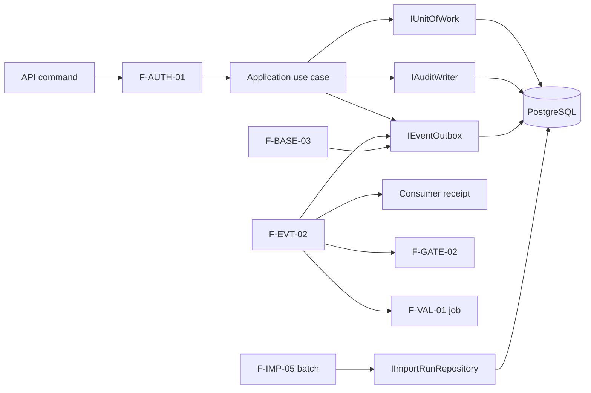

# Blocker Remediation Change Record

## Classification And Approval

- Change class: `Class D`
- Reason: authorization, persistence, event delivery, job cancellation, import
  transactions, and release controls are changed.
- Requirements approval: the controlled requirements in
  `requirements_baseline.md` already define the required behavior.
- Architecture approval: `software_architecture.md` already allocates the
  behavior to explicit functions and ports.
- Implementation approval: the user explicitly requested implementation on
  2026-06-13.

## Stakeholders And Needs

| Need ID | Stakeholder | Need |
|---|---|---|
| `NEED-QE-001` | Quality Engineer | Release only a baseline whose approval evidence and release gate are current. |
| `NEED-USER-001` | Project user | See only job and import details that the user's role and ownership permit. |
| `NEED-OP-001` | Operator | Recover event processing and long-running imports without silent data loss or duplicate effective work. |
| `NEED-AUD-001` | Auditor | Reconstruct who performed each controlled operation, under which role, and which downstream processing occurred. |

## Requirement Impact

No new externally observable capability is introduced. This change implements:

- `AAC-AUTH-FR-011` through `AAC-AUTH-FR-016`;
- `AAC-IMPORT-FR-080` through `AAC-IMPORT-FR-085`;
- `AAC-BASE-FR-060` through `AAC-BASE-FR-065`;
- `AAC-EVENT-AR-010` through `AAC-EVENT-AR-012`;
- `AAC-REV-FR-011` and `AAC-AUDIT-FR-010`.

The affected requirements are software requirements (`SRS`). Authorization and
event durability are security and constraint requirements; import, job, and
release behavior are functional requirements; response changes are interface
requirements.

## Architecture Decisions

### ADR-BLOCK-001: PostgreSQL Outbox Sequence

- Drivers: `AAC-EVENT-AR-010` through `012`, `AAC-BASE-FR-060` through `064`.
- Decision: persist domain events in PostgreSQL with a monotonically increasing
  sequence. State, audit, and outbox writes use the same transaction.
- Rationale: the sequence provides both at-least-once dispatch ordering and an
  unambiguous release-gate evaluation cutoff.
- Alternatives: Redis-only delivery was rejected because enqueue and canonical
  state cannot commit atomically. Timestamp-only cutoffs were rejected because
  equal timestamps and clock precision make ordering ambiguous.
- Risk: a dispatcher outage grows the outbox. Mitigation: retry metadata,
  dead-letter state, health visibility, and restart-safe claiming.

### ADR-BLOCK-002: Persisted Import Payload And Batch Checkpoint

- Drivers: `AAC-IMPORT-FR-083` through `085`.
- Decision: store the submitted normalized JSON on the import run. ARQ receives
  only import and job identifiers. Each batch commits its item outcomes and
  advances `last_committed_batch_index` atomically.
- Rationale: workers can resume after process or queue failure without depending
  on Redis payload retention.
- Alternative: one transaction per import was rejected because it cannot retain
  and report earlier successful batches.
- Risk: payload storage increases database size. Mitigation: version 1 retains
  payloads for auditability; retention policy remains a separate controlled
  change.
- Recovery behavior: an interrupted worker rolls back the active batch, records
  a retryable interruption, and asks ARQ to retry from the next uncommitted
  batch. The fifth failed attempt records the terminal `failed` state.

### ADR-BLOCK-003: Cooperative Cancellation

- Drivers: `AAC-IMPORT-FR-084`, `AAC-AUTH-FR-012`, `AAC-AUTH-FR-013`.
- Decision: cancellation sets a durable request flag. Workers observe it between
  transactions and record committed effects rather than claiming rollback.
- Risk: cancellation is not instantaneous inside one batch. Mitigation: fixed
  batch size of 100 and progress metadata.

### ADR-BLOCK-004: Release Final Guard

- Drivers: `AAC-BASE-FR-060` through `064`.
- Decision: release locks the baseline row and checks the latest passed result,
  its event-sequence cutoff, and all later blocking-relevant events in the same
  transaction.
- Concurrency ordering: append of a blocking-relevant event locks current
  passed release candidates before inserting the event. Event append and
  release therefore serialize on the same baseline row.
- Alternative: relying on the cached `release_gate_status` was rejected because
  consumer delay can leave it temporarily stale.
- Risk: event classification omissions could permit release. Mitigation: one
  controlled blocking-event registry and tests for each event family.

## Dependency Map Delta

## Verification

The authoritative mappings are maintained in
`verification/requirements_traceability.yaml`.

Evidence recorded on 2026-06-13:

- Ruff and Python bytecode compilation passed.
- Unit and contract suite passed: 108 tests; 2 database tests skipped when no
  integration URL is supplied.
- PostgreSQL integration suite passed: 2 tests covering second-batch state and
  outbox rollback/resume, and concurrent event/release ordering.
- Alembic upgraded a clean PostgreSQL 16 database through revision
  `0005_blocker_remediation`.
- Revision `0005_blocker_remediation` completed a downgrade/re-upgrade cycle.
- The startup schema-version guard accepted revision
  `0005_blocker_remediation`.
- A persisted outbox event received a database sequence and completed a
  dispatcher round trip to `delivered`.
