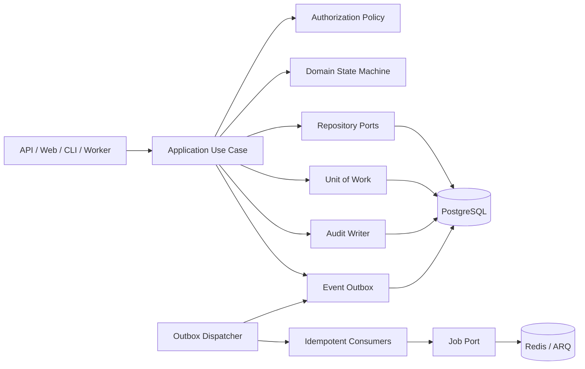
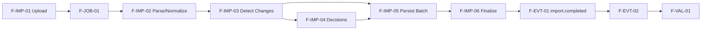
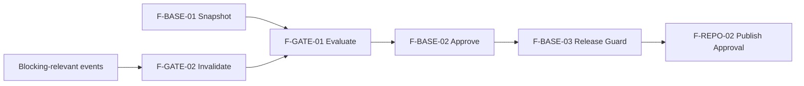
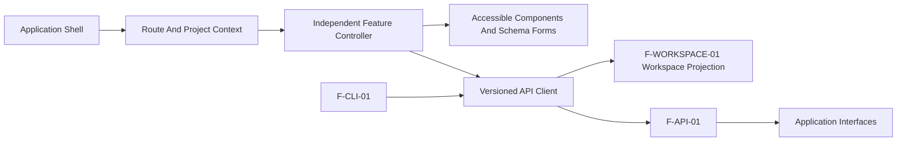
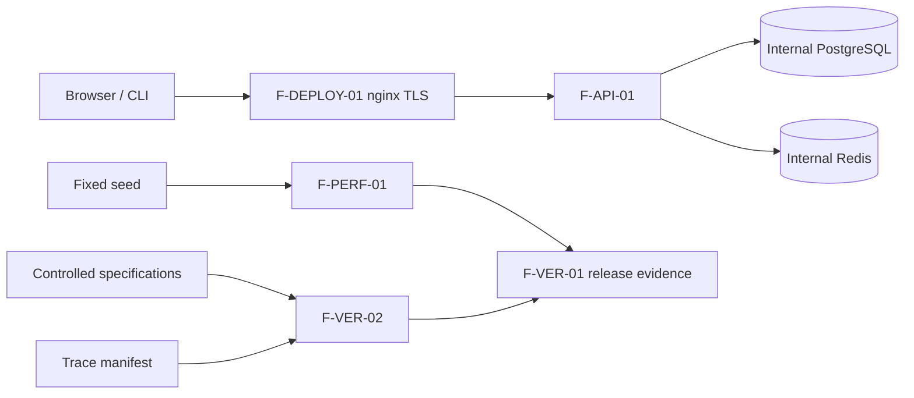

# Software Architecture

## 1. Status And Purpose

Document status: **controlled version 1 architecture**

Architecture date: **2026-06-12**

This document allocates the version 1 requirements to functions and interfaces.
It is authoritative for component ownership, allowed dependencies, transaction
boundaries, and change isolation. Technology choices remain in
`backend_architecture_and_technology_decisions.md`.

## 2. Architectural Principles

AAC-ARCH-001
Dependencies shall point inward:

```text
Web / CLI / API / Workers  ->  Application use cases  ->  Domain
                                      |
                                      v
                               Ports (interfaces)
                                      ^
                                      |
PostgreSQL / Redis / ARQ / GitHub / file adapters
```

Arrows show compile-time dependency. Adapters implement ports; ports never
depend on adapters.

AAC-ARCH-002
Domain functions shall not import FastAPI, SQLAlchemy, Redis, ARQ, HTTP clients,
or UI code.

AAC-ARCH-003
API routers, CLI commands, web handlers, and workers are adapters. They validate
transport data, invoke one application use case, and translate the result. They
shall not implement authorization, lifecycle, release, import, or validation
policy.

AAC-ARCH-004
One feature module shall not import another feature module's persistence adapter.
Cross-feature work shall occur through an application interface, a read port, or
a domain event.

AAC-ARCH-005
All external dependencies shall be accessed through explicit ports. Port
contracts shall use domain values or versioned data-transfer objects, not ORM
entities.

AAC-ARCH-006
Every state-changing use case shall define its authorization check, transaction
boundary, audit record, domain events, idempotency behavior, and error mapping.

## 3. Logical Components

| Component | Responsibility | May Depend On |
|---|---|---|
| `presentation.api` | HTTP request/response and OpenAPI | application interfaces, contract schemas |
| `presentation.web` | Browser shell, task routing, accessible rendering, and feature controllers | versioned HTTP API client and canonical presentation metadata only |
| `presentation.cli` | CLI workflow and rendering | HTTP API client only |
| `application` | Use-case orchestration and transactions | domain, ports |
| `domain.identity` | authentication and authorization policy | domain values |
| `domain.artefacts` | artefact/relationship lifecycle and revision policy | domain values |
| `domain.imports` | import state machine and decision policy | domain values, canonical schema interface |
| `domain.validation` | rule evaluation and issue policy | domain values, rule catalog interface |
| `domain.traceability` | graph queries | domain values |
| `domain.impact` | impact and suspect policy | domain values, traceability interface |
| `domain.baselines` | snapshot, gate, approval, and release state machines | domain values, validation read interface |
| `domain.reports` | report projections | read interfaces |
| `domain.events` | event envelope and consumer contracts | domain values |
| `ports` | repository, unit-of-work, job, event, clock, ID, and integration interfaces | domain values |
| `adapters.persistence` | PostgreSQL/SQLAlchemy implementations | ports, ORM |
| `adapters.jobs` | Redis/ARQ queue implementations | job ports |
| `adapters.github` | GitHub connector | repository integration port |
| `workers` | invoke resumable application use cases | application interfaces |

## 4. Function Catalog And Dependency Map

Every row is the visible dependency map for one architecture function. A direct
dependency not listed here is prohibited until this document is updated.

| Function ID | Function | Direct Dependencies | Output / Events | Independent Change Boundary |
|---|---|---|---|---|
| `F-ID-01` | Authenticate credentials and issue JWT | `IUserReader`, `IPasswordHasher`, `ITokenIssuer`, `IClock` | token or authentication error; audit login outcome | password/token adapters |
| `F-AUTH-01` | Authorize an operation | `IMembershipReader`, authorization policy | permit/deny decision | role policy |
| `F-ART-01` | Create artefact revision 1 | `F-AUTH-01`, `ISchemaRegistry`, `IArtefactRepository`, `IUnitOfWork`, `IAuditWriter`, `IEventOutbox` | artefact/revision; `artefact.created` | artefact domain |
| `F-ART-02` | Revise an artefact | `F-AUTH-01`, `ISchemaRegistry`, `IArtefactRepository`, `IUnitOfWork`, `IAuditWriter`, `IEventOutbox` | new immutable revision; `artefact.revised` | revision policy |
| `F-REL-01` | Create/revise/delete relationship | `F-AUTH-01`, `IRelationshipRepository`, `IRelationshipPolicy`, `IUnitOfWork`, `IAuditWriter`, `IEventOutbox` | relationship revision/events | relationship domain |
| `F-IMP-01` | Accept import upload | `F-AUTH-01`, `IUploadPolicy`, `IJobQueue`, `IImportRunRepository` | queued import/job ID; `import.started` audit | transport/upload policy |
| `F-IMP-02` | Parse and normalize Sphinx data | `ISphinxParser`, `ISchemaRegistry`, `IImportRunRepository` | normalized import DTOs/item errors | Sphinx adapter |
| `F-IMP-03` | Detect new/changed/unchanged/deleted/conflict items | `IArtefactReader`, import comparison policy | classified import plan | comparison policy |
| `F-IMP-04` | Record import decisions | `F-AUTH-01`, `IImportRunRepository`, import state machine, `IUnitOfWork`, `IAuditWriter`, `IEventOutbox` | accepted/rejected plan; `import.decision_submitted` | decision workflow |
| `F-IMP-05` | Persist one import batch | `F-ART-01`, `F-ART-02`, `F-REL-01`, `IImportRunRepository`, `IUnitOfWork`, `IEventOutbox` | committed batch index and item outcomes | batch transaction |
| `F-IMP-06` | Finalize or cancel import | import state machine, `IImportRunRepository`, `IUnitOfWork`, `IAuditWriter`, `IEventOutbox` | terminal state; `import.completed` or `import.cancelled` | import orchestration |
| `F-EVT-01` | Append domain event transactionally | `IEventOutbox`, `IBaselineRepository`, blocking relevance policy, active `IUnitOfWork` | pending outbox record; release-candidate ordering lock for blocking events | event persistence |
| `F-EVT-02` | Dispatch outbox event | `IEventOutbox`, `IEventConsumerRegistry`, `IClock` | delivered/retry/dead-letter state | dispatcher |
| `F-JOB-01` | Create and query job | `F-AUTH-01`, `IJobRepository`, `IJobQueue` | job resource | queue implementation |
| `F-JOB-02` | Cooperatively cancel job | `F-AUTH-01`, `IJobRepository`, `IJobCancellation`, `IAuditWriter` | cancellation request/result | cancellation protocol |
| `F-VAL-01` | Run validation | `IRuleCatalog`, `IValidationDataReader`, `IValidationIssueRepository`, `IUnitOfWork`, `IEventOutbox` | validation result/issues/events | rule engine |
| `F-TRACE-01` | Query trace graph | `ITraceGraphReader` | forward/backward graph DTO | graph storage/query |
| `F-IMPACT-01` | Calculate impact | `F-TRACE-01`, `ISuspectRepository`, impact policy | impact result | impact policy |
| `F-SUSP-01` | Propagate or clear suspects | `ITraceGraphReader`, `ISuspectRepository`, `IUnitOfWork`, `IAuditWriter`, `IEventOutbox` | suspect state/events | suspect policy |
| `F-BASE-01` | Create immutable baseline snapshot | `F-AUTH-01`, `IProjectLock`, `IBaselineRepository`, `IRevisionSnapshotReader`, `IRepositoryRevisionReader`, `IUnitOfWork`, `IEventOutbox` | snapshot; `baseline.created` | snapshot composition |
| `F-GATE-01` | Evaluate release gate | `F-AUTH-01`, `IBaselineReader`, `IValidationDataReader`, `IRuleCatalog`, `IGateResultRepository`, `IUnitOfWork`, `IEventOutbox` | passed/failed gate result | gate policy |
| `F-GATE-02` | Invalidate stale gate/approval | `IBaselineRepository`, blocking relevance policy, `IUnitOfWork`, `IAuditWriter`, `IEventOutbox` | stale gate; optional approval invalidation | staleness policy |
| `F-BASE-02` | Approve baseline | `F-AUTH-01`, `IBaselineRepository`, current-gate policy, `IUnitOfWork`, `IAuditWriter`, `IEventOutbox` | approved baseline | approval policy |
| `F-BASE-03` | Release baseline | `F-AUTH-01`, `IBaselineRepository`, current-gate policy, `IUnitOfWork`, `IAuditWriter`, `IEventOutbox` | released baseline; `baseline.released` | release guard |
| `F-REP-01` | Generate report | `F-AUTH-01`, `IReportDataReader`, `IReportRepository`, `IJobRepository` | versioned JSON report | report projection |
| `F-REPO-01` | Scan repository | `F-AUTH-01`, `IRepositoryConnector`, `IRepositoryMappingParser`, `IArtefactCommands`, `IUnitOfWork`, `IEventOutbox` | scan result/revisions/events | GitHub/mapping adapter |
| `F-REPO-02` | Publish repository approval | `F-AUTH-01`, `IBaselineReader`, `IRepositoryConnector`, `IAuditWriter` | check run or commit status | GitHub publication |
| `F-WORKSPACE-01` | Project browser-workspace projection | `F-AUTH-01`, `IMembershipReader`, project/artefact/import/validation/suspect/baseline/job read ports | effective roles, named capabilities, work summaries, and resource actions | read-only presentation projection |
| `F-API-01` | Execute HTTP command/query | request schema, one application interface, response/error mapper | standard API envelope | FastAPI adapter |
| `F-WEB-01` | Execute accessible task workflow | application shell, route/context store, versioned API client, workspace projection, schema-form renderer, reusable components, feature controller | rendered workflow state and API commands | independently replaceable web feature |
| `F-CLI-01` | Execute CLI workflow | generated/typed API client | exit code and rendered result | CLI adapter |
| `F-VER-01` | Produce release evidence | requirements trace manifest, test runners, deployment checks | immutable verification manifest | verification tooling |
| `F-VER-02` | Inventory requirement and acceptance status | controlled Markdown specifications, trace manifest, filesystem evidence | complete `missing`/`implemented`/`verified`/`waived` inventory | traceability tooling |
| `F-PERF-01` | Seed and benchmark MVP-scale data | migration head, deterministic seed, PostgreSQL benchmark adapter | percentile result manifest and blocking status | performance tooling |
| `F-DEPLOY-01` | Expose production service securely | TLS certificate/key, nginx policy, internal Compose network, runtime configuration validator | HTTPS service; redirect from HTTP; startup rejection on unsafe configuration | deployment adapter |

## 5. Port And Interface Contracts

| Interface ID | Contract |
|---|---|
| `IUnitOfWork` | `begin()`, `commit()`, `rollback()`; repositories and outbox share the same transaction |
| `IUserReader` | Read active user and credential material without exposing password hashes outside identity |
| `IMembershipReader` | Return actor roles for a project and global Admin status |
| `IPasswordHasher` | Verify a supplied password against a stored hash and create hashes using the configured algorithm |
| `ITokenIssuer` | Issue and validate signed access tokens with actor, expiry, and correlation claims |
| `IClock` | Supply UTC time for deterministic domain logic and tests |
| `ISchemaRegistry` | `get(type, version)`, `validate(type, version, payload)`, `latest(type)`, and optional versioned presentation metadata for canonical fields |
| `IWorkspaceProjection` | Read effective actor roles, named capabilities, actionable-work counts, active jobs, validation/suspect summaries, and latest release state without mutating domain data |
| `IUploadPolicy` | Stream-validate media type and size and reject input above the configured limit before full buffering |
| `ISphinxParser` | Parse a supported Sphinx-Needs export into source DTOs without persistence side effects |
| `IArtefactReader` | Read current artefact identity, revision, fingerprint, type, source, and lifecycle state |
| `IArtefactRepository` | Read current revision with concurrency token; append revision; atomically advance current pointer |
| `IRelationshipRepository` | Read and append immutable relationship revisions |
| `IRelationshipPolicy` | Validate permitted source type, target type, relationship type, and lifecycle operation |
| `IImportRunRepository` | Persist state, items, decisions, counts, and `last_committed_batch_index` |
| `IEventOutbox` | Append in active transaction; claim pending; mark delivered; schedule retry; dead-letter |
| `IEventConsumerRegistry` | Resolve ordered idempotent consumers by event type |
| `IJobQueue` | Enqueue by job ID and idempotency key; no business payload is authoritative in Redis |
| `IJobRepository` | Persist requester, project, state, progress, cancellation, error, correlation, and committed-effects metadata |
| `IJobCancellation` | Request cancellation and expose a cooperative cancellation check at transaction boundaries |
| `IRuleCatalog` | Return versioned rules and active profile severity/blocking policy |
| `IValidationDataReader` | Supply immutable evaluation input scoped to project or baseline |
| `IValidationIssueRepository` | Reconcile issues for a run and append raised/resolved issue events in the active unit of work |
| `ITraceGraphReader` | Traverse permitted relationships with depth and cycle controls |
| `ISuspectRepository` | Read, append, and clear suspect states with concurrency protection |
| `IProjectLock` | Acquire/release project update lock with owner and expiry |
| `IRevisionSnapshotReader` | Return exact active artefact and relationship revision IDs for a locked project scope |
| `IRepositoryRevisionReader` | Return exact active connector and commit revisions for baseline snapshotting |
| `IBaselineReader` | Read immutable snapshot content, lifecycle state, approval metadata, and gate currency inputs |
| `IBaselineRepository` | Persist immutable snapshot and guarded lifecycle transitions |
| `IGateResultRepository` | Append evaluations and read newest current result |
| `IReportDataReader` | Return immutable traceability, baseline comparison, or validation-summary projection input |
| `IReportRepository` | Persist and retrieve versioned generated JSON reports |
| `IRepositoryConnector` | Read exact commit, checks, files, and publish approval without exposing credentials |
| `IRepositoryMappingParser` | Validate `.aac/repo.yml` and return provider-independent mapping DTOs |
| `IArtefactCommands` | Invoke authorized artefact and relationship application commands using the originating command context |
| `IAuditWriter` | Append immutable action record with actor role, operation, correlation, and before/after references |
| `IVerificationInventory` | Discover every normative requirement and acceptance ID, validate linked architecture/code/test paths, and assign one controlled status |
| `IDeploymentConfiguration` | Supply non-default secrets, HTTPS enforcement, explicit CORS origins, bounded request sizes, and TLS certificate material |

All state-changing application interfaces accept:

```text
CommandContext {
  actor_id,
  project_id,
  correlation_id,
  request_id,
  idempotency_key
}
```

They return a typed result or a typed domain error. The API adapter owns mapping
domain errors to HTTP statuses and the standard error envelope.

## 6. Component Dependency Diagrams

### 6.1 Commands, Persistence, Audit, And Events



### 6.2 Import



The import parser, comparison policy, decision workflow, batch writer, and
validation consumer communicate through DTOs and ports. Changing Sphinx parsing
does not require changing revision persistence or validation policy.

### 6.3 Baseline And Release



Repository approval publication depends on a released baseline query. It cannot
call, bypass, or duplicate the baseline release function.

### 6.4 Presentation



Web and CLI contain no independent domain rules. An API contract change is
isolated through the versioned client and contract tests.

The web dependency direction is:

```text
bootstrap -> router/context -> feature controller -> API client -> HTTP API
                                     |
                                     +-> reusable components/schema renderer
```

Views and components do not call `fetch`. Feature controllers do not infer
authorization or valid lifecycle transitions. The workspace projection and
resource `allowed_actions` are presentation metadata only; command endpoints
remain authoritative and repeat all authorization and state checks.

Static HTML, CSS, and native ES modules are served by the existing `/app`
deployment mount. No production JavaScript build process or frontend framework
is introduced.

### 6.5 Deployment And Verification



PostgreSQL, Redis, and the application server are not published by the
production Compose adapter. TLS termination and security headers are owned by
nginx. Development Compose remains independently configurable and is not
treated as production evidence.

## 7. Transaction And Consistency Boundaries

| Operation | Transaction Boundary | Consistency Rule |
|---|---|---|
| Artefact/relationship revision | one transaction | append revision, advance current pointer, audit, and outbox together |
| Import batch | one transaction per batch | no partial batch; committed batch index advances in same transaction |
| Import finalization | one transaction | terminal state and completion event together |
| Baseline snapshot | one controlled transaction after lock/eligibility | exact immutable revision IDs and repository commits |
| Gate evaluation result | one transaction | result, baseline gate status, audit, and event together |
| Gate invalidation | one transaction | stale status and approval invalidation together |
| Baseline release | one serializable or locked transaction | final gate guard and released state are atomic |
| Audit append | caller's state transaction | an audited change cannot commit without its audit record |
| Event append | caller's state transaction | a committed event-producing change cannot lack its outbox record |

Blocking-relevant event append and baseline release use the same baseline-row
ordering point. If event append obtains the lock first, release waits and then
observes the committed event. If release obtains it first, the event is ordered
after the committed release. This closes the check/commit race without relying
on dispatcher timing.

## 8. Event Consumer Map

| Event | Consumer Function | Idempotency Key |
|---|---|---|
| `import.completed` | `F-VAL-01` | import run ID + validation mode |
| `artefact.revised` | `F-SUSP-01`, validation enqueue | event ID per consumer |
| `relationship.created/revised/deleted` | traceability refresh, validation enqueue | event ID per consumer |
| `validation.issue_raised/resolved` | `F-GATE-02` | baseline ID + event ID |
| `suspect.opened/cleared` | `F-GATE-02` | baseline ID + event ID |
| profile/rule/tailoring changed | `F-GATE-02` | baseline ID + configuration version |
| `baseline.released` | repository publication eligibility, post-release propagation | baseline ID + event ID |

## 9. Change Isolation Rules

1. A schema change updates `ISchemaRegistry` data and schema contract tests; it
   shall not require API router or repository control-flow changes.
2. A new import source implements a parser/normalizer port and reuses
   `F-IMP-03` through `F-IMP-06`.
3. A rule change updates the versioned rule catalog and rule tests; it shall not
   modify baseline transition code.
4. A UI change uses the API client and shall not import backend domain modules.
5. A queue technology change implements job ports without changing use cases.
6. A database change implements repository ports and migrations without leaking
   ORM entities into domain or presentation layers.
7. A repository provider change implements `IRepositoryConnector` without
   changing baseline release policy.
8. Cross-module cycles are prohibited and shall fail architecture tests.

## 10. Requirements Traceability

| Requirement Group | Architecture Functions | Primary Interfaces | Acceptance |
|---|---|---|---|
| Governance and scope | `F-VER-01` | trace, classification, change, approval, spike, and architecture-decision manifests | `ACC-GOV-001` to `ACC-GOV-015` |
| Authorization | `F-AUTH-01`, all command functions | `IMembershipReader`, `IAuditWriter` | `ACC-AUTH-001` to `ACC-AUTH-010`, `ACC-JOB-006` |
| Import consistency | `F-IMP-01` to `F-IMP-06` | `IImportRunRepository`, `ISchemaRegistry` | `ACC-IMP-001` to `ACC-IMP-014` |
| Release staleness | `F-GATE-01`, `F-GATE-02`, `F-BASE-02`, `F-BASE-03` | `IBaselineRepository`, `IGateResultRepository` | `ACC-BASE-005` to `ACC-BASE-015` |
| Security/API | `F-ID-01`, `F-AUTH-01`, `F-API-01`, `F-IMP-01` | token, upload, error contracts | `ACC-API-001` to `ACC-API-007`, `ACC-SEC-001` to `ACC-SEC-007` |
| Reliable events | `F-EVT-01`, `F-EVT-02` | `IEventOutbox`, `IEventConsumerRegistry` | `ACC-EVENT-001` to `ACC-EVENT-004` |
| Revision/audit | `F-ART-01`, `F-ART-02`, `F-REL-01` | revision repositories, `IAuditWriter` | `ACC-ART-003`, `ACC-ART-006`, `ACC-DATA-005`, `ACC-DATA-006` |
| Canonical schema | all create/revise/import functions | `ISchemaRegistry` | `ACC-SCHEMA-001` to `ACC-SCHEMA-003` |
| Web and CLI | `F-WEB-01`, `F-WORKSPACE-01`, `F-CLI-01`, `F-API-01` | versioned API client, `IWorkspaceProjection`, `ISchemaRegistry` | `ACC-UI-001` to `ACC-UI-010` |
| Repository integration | `F-REPO-01`, `F-REPO-02` | `IRepositoryConnector` | `REPO-ACC-001` to `REPO-ACC-015` |

## 11. Architecture Verification

The implementation shall include automated checks that:

- domain packages do not import framework or adapter packages;
- presentation and worker packages call application interfaces only;
- feature modules do not import another feature's persistence adapter;
- every state-changing use case writes audit and outbox records in its unit of
  work where required;
- every registered event consumer declares an idempotency strategy;
- OpenAPI, generated clients, and response-envelope contract tests agree;
- the generated requirements inventory contains every discovered version 1
  identifier and explicitly reports any unallocated item as `missing`.
